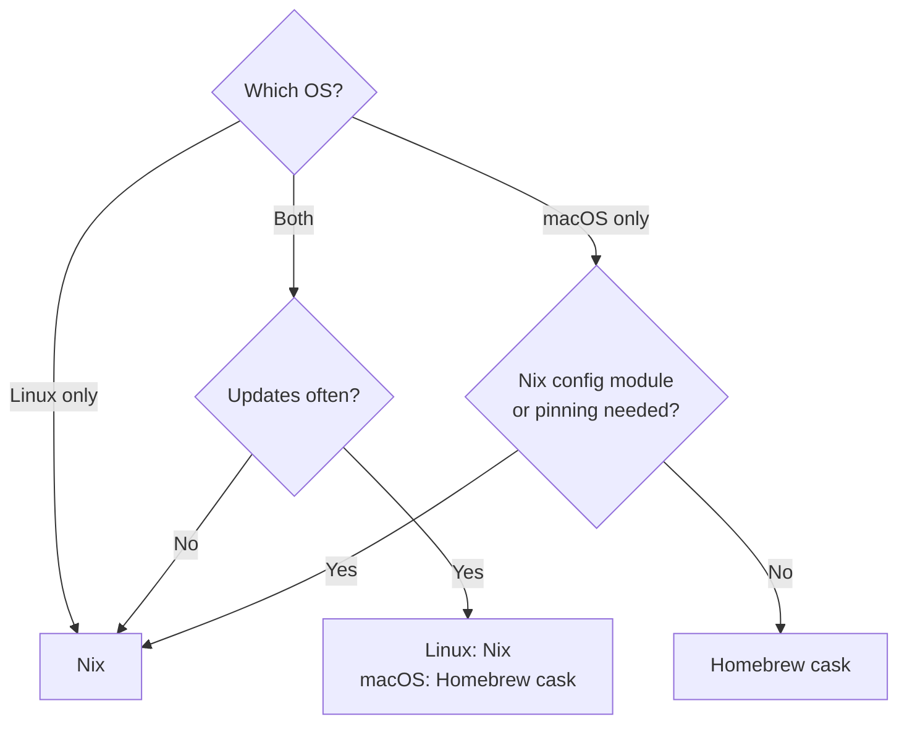

# dot-files
My dot-files repository which uses **Nix** (via Home Manager and nix-darwin) for fully declarative and reproducible configuration across NixOS, macOS, and generic Linux distributions.

## Repository Structure

```
dot-files/
├── flake.nix              # Main flake defining all configurations
├── apply.sh               # Automatic installation script
├── Vagrantfile            # Rocky Linux 9 VM for testing server config
├── home/                  # Home-manager configurations
│   ├── default.nix        # Shared base for all platforms (session vars, stateVersion)
│   ├── linux.nix          # Linux desktop entry point (imports default + programs/desktop + Linux-only programs)
│   ├── darwin.nix         # macOS entry point (imports default + programs/desktop)
│   ├── server.nix         # Server entry point (imports default + programs/cli)
│   ├── kali/              # Kali entry point
│   │   ├── default.nix    # Imports default + programs/cli + tools
│   │   └── tools.nix      # Pentesting tools
│   └── programs/          # Program-specific configurations
│       ├── cli.nix        # CLI programs + packages (server profile)
│       ├── desktop.nix    # Desktop programs + packages (imports cli)
│       ├── fonts.nix      # Nerd fonts
│       ├── atuin.nix      # Shell history sync
│       ├── git.nix        # Git configuration
│       ├── kitty.nix      # Terminal emulator
│       ├── neovim.nix     # Neovim configuration
│       ├── obsidian.nix   # Note-taking app (Linux only)
│       ├── starship.nix   # Shell prompt
│       ├── syncthing.nix  # File synchronization (Linux only)
│       ├── tmux.nix       # Terminal multiplexer
│       ├── vicinae.nix    # App launcher + systemd service (Linux only)
│       ├── vscode.nix     # VSCodium with extensions
│       └── zsh.nix        # Shell configuration
├── hosts/                 # System-level configurations
│   ├── darwin/            # macOS system settings (nix-darwin)
│   │   ├── configuration.nix # System defaults, Homebrew casks, Tailscale, PATH
│   │   ├── yabai.nix      # Tiling window manager (system service)
│   │   ├── skhd.nix       # Hotkey daemon (system service)
│   │   └── jankyborders.nix # Window border highlights (system service)
│   └── nixos/             # NixOS system configuration
├── scripts/
│   └── check-eval.sh      # Evaluates every configuration (pre-commit hook, with nixfmt)
├── wallpaper/             # Wallpaper images
└── files/                 # Dotfiles managed via home.file
    ├── karabiner/         # Karabiner-Elements keyboard config
    └── nvim/              # Neovim lua config
```

# Installation

## The Quick Way
### Linux & macOS

Run the following command in your terminal to bootstrap your entire system:

```bash
curl -L https://raw.githubusercontent.com/the-c0d3r/dot-files/master/apply.sh | bash
```

Alternatively, if you've already cloned the repo:

```bash
./apply.sh                  # auto-detects OS and profile
./apply.sh --server         # server mode (CLI tools only, no GUI)
./apply.sh --vm             # build and launch NixOS QEMU test VM
```

> [!IMPORTANT]
> The script automatically generates `vars.nix` with your username before running with sudo. This file is gitignored but must be present for the configuration to build.

> [!NOTE]
> Supported platforms: x86_64 Linux, Apple Silicon macOS. aarch64 Linux and Intel macOS are not supported.

## Uninstallation

To remove the configurations and symlinks created by these dotfiles:

```bash
./uninstall.sh
```

To see what would be removed without actually deleting anything:

```bash
./uninstall.sh --dry-run
```

> [!NOTE]
> After cleaning up the dotfiles configuration, the script also runs the Determinate Nix uninstaller (`/nix/nix-installer uninstall`) when present, which removes Nix itself.

## Subsequent Updates
To apply any changes to your configuration later, simply run:

```bash
./apply.sh
```

> [!NOTE]
> `apply.sh` automatically detects your OS and distribution to apply the correct configuration (`#linux`, `#kali`, `#codelab-nix`, `#mac-arm`, etc.).

## Manual Build (Advanced)

For NixOS:
```bash
echo "{ username = \"yourusername\"; }" > vars.nix
git add -f vars.nix  # Required for flakes
sudo nixos-rebuild switch --flake .#codelab-nix
```

For generic Linux:
```bash
echo "{ username = \"yourusername\"; }" > vars.nix
git add -f vars.nix
home-manager switch --flake .#linux
```

For macOS:
```bash
echo "{ username = \"yourusername\"; }" > vars.nix
git add -f vars.nix
sudo darwin-rebuild switch --flake .#mac-arm
```

# Profiles

## `linux` - Standalone Linux (home-manager only)
- Terminal tools + desktop environment
- Vicinae app launcher, Syncthing, Zen Browser, Signal, TickTick
- Vagrant + VirtualBox
- LibreOffice, VLC, Node.js
- Fonts (Nerd Fonts)
- Suitable for: Arch, Ubuntu, Fedora, etc.

## `server` - Headless Linux (home-manager only)
- CLI tools only: Neovim, Tmux, Zsh, Atuin, Starship
- No GUI packages or desktop environment
- Suitable for layering on top of any existing Linux server

## `kali` - Kali Linux
- CLI tools from the `server` profile, without the desktop stack
- Adds pentesting tools: enum4linux, smbmap, feroxbuster, nikto, sslscan, etc. (`home/kali/tools.nix`)

## `codelab-nix` - NixOS
- Full NixOS system configuration (KDE Plasma 6, X11, NVIDIA)
- VirtualBox at system level (kernel modules via `virtualisation.virtualbox.host`)
- System-level services and settings
- Home-manager integrated

## `mac-arm` - macOS (Apple Silicon)
- System settings (Dock, Finder, keyboard, trackpad)
- Yabai + skhd for tiling window management
- Homebrew integration: self-updating macOS-only apps are declared as casks in `homebrew.casks`; other Homebrew installs are left alone
- Fonts via home-manager

> [!WARNING]
> Applying the macOS configuration **WILL** modify your system settings. This includes Dock arrangement, Finder preferences, keyboard remappings (Caps Lock -> Escape), and trackpad settings. Review [hosts/darwin/configuration.nix](hosts/darwin/configuration.nix) before applying.

# Testing

## NixOS VM (QEMU)
Build and launch a QEMU VM with your full NixOS config applied:
```bash
./apply.sh --vm
```
Login with your username, password: `test`

## Server Config (Vagrant + Rocky Linux 9)
Test the `--server` profile on a Rocky Linux VM:
```bash
vagrant up        # provision and apply --server
vagrant provision # re-run apply.sh after changes
vagrant ssh       # SSH in to test manually
```

# Programs & Configs

## Where to install an app



- Nix copies can't self-update; they move only when nixpkgs does.
- Casks self-update and handle drivers, installers and macOS permissions.
- Casks are declared in `homebrew.casks` ([hosts/darwin/configuration.nix](hosts/darwin/configuration.nix)), so `./apply.sh` installs them. Homebrew installs not listed there are left alone.

## Shared (All Platforms)
- **Neovim**: Customized vim configuration (NvChad, Everforest light/dark following the system appearance)
- **Tmux**: Terminal multiplexer with custom keybindings; nova status bar in Everforest light/dark following the terminal
- **Zsh**: Shell with oh-my-zsh integration
- **Kitty**: GPU-accelerated terminal (JetBrainsMono Nerd Font, Everforest light/dark auto themes following the system appearance)
- **Starship**: Cross-shell prompt
- **Atuin**: Shell history sync and search
- **Git**: Version control with custom config
- **VSCodium**: VS Code with everyday extensions in Nix (vim, typst, nix, python, yaml, toml, rpm spec), Everforest theme following macOS light/dark; others (e.g. Claude Code) are installed manually. Quit VSCodium before rebuilding when the extension list changes.
- **Obsidian**: Note-taking app (Nix on Linux, Homebrew cask on macOS; installer updates: `brew upgrade --cask --greedy obsidian`)
- **Ripgrep**, **FD**: Modern search tools
- **Htop**, **Ncdu**, **Jq**: System utilities
- **Discord**, **KeePassXC**: Desktop applications
- **Development Tools**: pre-commit, uv (Python env manager)

## Linux Only
- **Vicinae**: Application launcher with systemd daemon (rofi replacement)
- **Syncthing**: File synchronization service
- **Zen Browser**: Privacy-focused browser
- **Vagrant** + **VirtualBox**: Virtualisation (VirtualBox via kernel module on NixOS)
- **LibreOffice**: Office suite
- **VLC**: Media player
- **Node.js**: JavaScript runtime (nodejs_24)
- **Fonts**: Nerd Fonts (via home-manager)

## macOS Only
- **Yabai**: Tiling window manager (system service)
- **Skhd**: Hotkey daemon (system service)
- **JankyBorders**: Window border highlights
- **Raycast**: Spotlight replacement (Homebrew cask)
- **Itsycal**: Menubar calendar (Homebrew cask)
- **Slack, Mos, Shortcat**: chat, smooth scrolling, keyboard navigation (Homebrew casks)
- **Tailscale**: VPN daemon via nix-darwin's `services.tailscale` (launchd)
- **GNU Utils**: coreutils, gnused, gnutar, gnugrep (replaces BSD variants)

## macOS System Settings
The following macOS defaults are declaratively managed via [hosts/darwin/configuration.nix](hosts/darwin/configuration.nix):

- **General**:
    - Appearance unmanaged (toggled manually; kitty, tmux and nvim follow it)
    - Metric units (Celsius, cm)
    - Fast key repeat rate (Initial: 25, Repeat: 2)
    - Auto-capitalization/correction/dashes/periods/quotes **DISABLED**
- **Dock**:
    - Auto-hide disabled
    - Positioned on the **Left**
    - Recent apps hidden
    - **Hot Corners**:
        - Top-Left: Mission Control
        - Bottom-Left: Lock Screen
        - Bottom-Right: Desktop
- **Finder**:
    - Show all file extensions
    - Show POSIX path in title bar
    - Default view style: List View
    - Folders sorted first
- **Trackpad**:
    - Tap to click enabled
    - Three-finger drag enabled
    - Two-finger right click enabled
- **Keyboard**:
    - Remap **Caps Lock** to **Escape**
- **Control Center**:
    - Battery percentage shown

## Fonts

All desktop platforms include (via `home/programs/fonts.nix`):
- JetBrains Mono Nerd Font
- Symbols Only Nerd Font
- Fira Code Nerd Font
- Inconsolata Nerd Font
- Iosevka Nerd Font
- Karla
